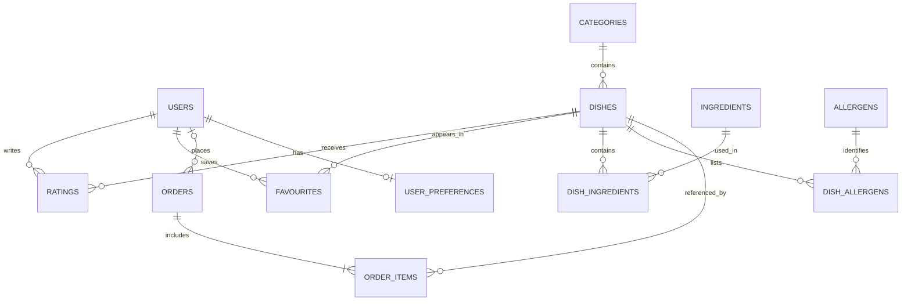

# Database design — proposed v0.1

This is a design for PostgreSQL, not a running migration. The current API serves in-memory sample data and does not connect to a database. We will implement models and Alembic migrations during the next build stage, then update this design to match the implementation.

## Entities and relationships

- **users**: id, name, email (unique), password_hash, role (`customer` or `manager`), created_at. One user can have many ratings, favourites and orders. Passwords must be hashed, never stored as plain text.
- **categories**: id, name, description. One category has many dishes.
- **dishes**: id, category_id, name, description, price_rwf, image_url, is_available, created_at, updated_at. Prices are non-negative. Dish records are deactivated rather than deleted if referenced by orders.
- **ingredients**: id, name (unique). **dish_ingredients** links dishes and ingredients, with a composite primary key.
- **allergens**: id, name (unique). **dish_allergens** links dishes and allergens. Include an allergen-information status on dishes (`unknown`, `reviewed`), so missing data is not treated as safe. Cross-contact requires a warning and restaurant verification.
- **dietary_labels** and **dish_dietary_labels**: restaurant-verified labels such as vegetarian; no automatic assumption from missing ingredient data.
- **user_preferences**: user_id (one per user), max_budget_rwf, updated_at. Add join tables for dietary requirements and excluded allergens. Never infer an allergen-safe dish when information is unknown.
- **ratings**: user_id, dish_id, rating (integer 1–5), created_at, updated_at; unique `(user_id, dish_id)` so a user can change their rating without duplicating it.
- **favourites**: user_id, dish_id, created_at; composite primary key.
- **orders**: id, user_id (nullable for guests if that workflow is adopted), table_number, status, created_at, updated_at. Example statuses: `pending`, `accepted`, `preparing`, `completed`, `cancelled`.
- **order_items**: id, order_id, dish_id, dish_name_snapshot, quantity and unit_price_rwf_at_order. Preserve the name and price used when the order was placed; quantity must be positive.

All foreign keys and deletion policies will be specified in migrations; order history must not disappear if a dish is disabled. Add indexes for menu availability/category, order status/time and ratings by dish. Use transactions when saving orders. Currency is RWF; use integer RWF amounts until restaurant requirements say otherwise.

## Relationship overview

## Privacy and accuracy

Collect only information needed for the project, obtain appropriate consent, and use anonymised or demonstrably fictional data where possible. Dietary/allergen information must be checked with the restaurant. This design does not yet implement consent, retention, authentication or access control.
