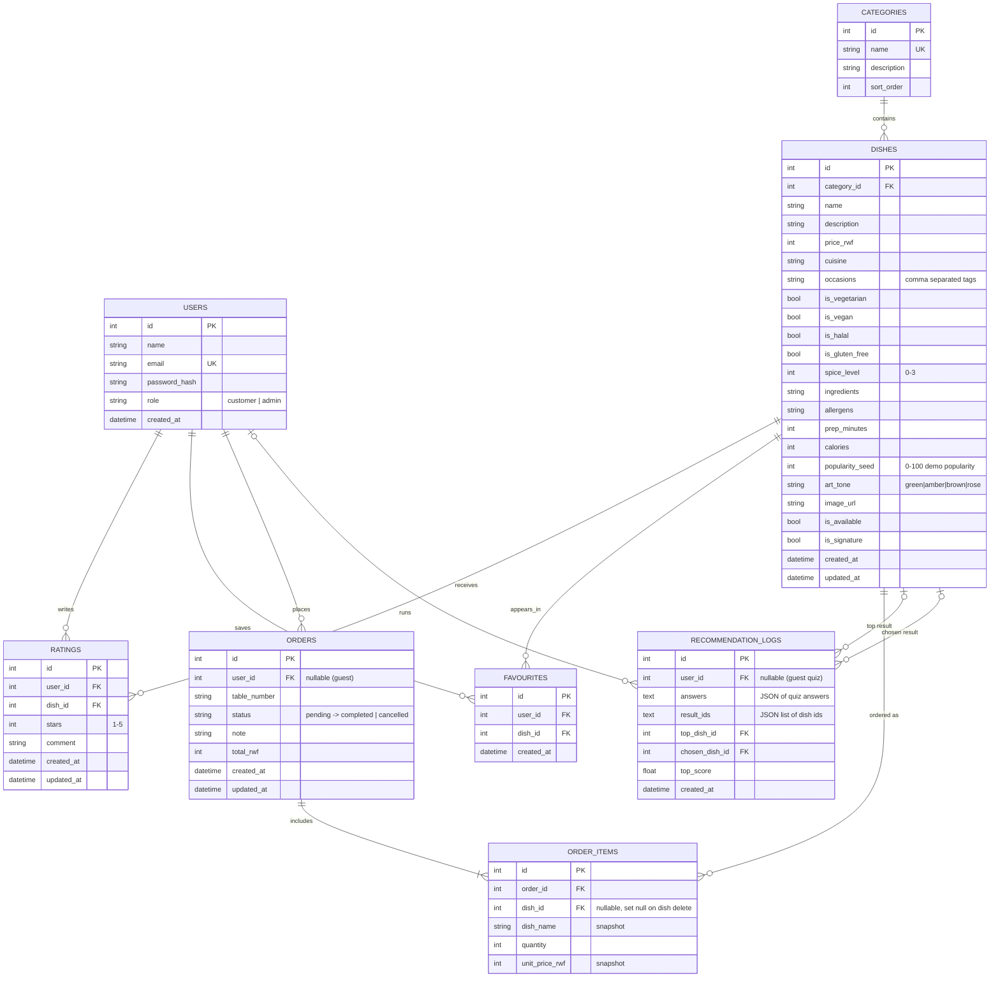

# Camelia AI Menu — Database Schema (v1.0)

The implemented schema. It supersedes the earlier proposal in `DATABASE-DESIGN.md`
(which described an eight-entity design; the built system uses the eight tables below).

- Engine: SQLAlchemy 2.0 ORM
- Local development: SQLite (`backend/camelia.db`)
- Production: PostgreSQL (Neon / Render) — same models, `DATABASE_URL` switches the driver
- Tables are created at startup (`Base.metadata.create_all`); the demo data set is loaded
  automatically when the database is empty. Alembic is not used yet.

---

## Entity–relationship diagram

---

## Data dictionary

### users
| Column | Type | Rules |
|---|---|---|
| id | integer | primary key |
| name | varchar(120) | required |
| email | varchar(255) | unique, indexed, stored lowercase |
| password_hash | varchar(255) | bcrypt hash, never plain text |
| role | varchar(20) | `customer` or `admin`; self-registration always produces `customer` |
| created_at | timestamptz | defaults to UTC now |

### categories
| Column | Type | Rules |
|---|---|---|
| id | integer | primary key |
| name | varchar(80) | unique |
| description | varchar(255) | optional |
| sort_order | integer | display order |

### dishes
| Column | Type | Rules |
|---|---|---|
| id | integer | primary key |
| name | varchar(120) | required, unique per case-insensitive check in the API |
| category_id | integer | FK → categories.id, indexed |
| price_rwf | integer | Rwandan francs, ≥ 0 |
| cuisine | varchar(40) | `Rwandan`, `African`, `International` |
| occasions | varchar(160) | comma separated: `quick-bite,casual,date,celebration,family` |
| is_vegetarian / is_vegan / is_halal / is_gluten_free | boolean | restaurant-verified labels, not inferred |
| spice_level | integer | 0 none · 1 mild · 2 medium · 3 hot |
| ingredients | text | comma separated, displayed as a list |
| allergens | varchar(255) | comma separated; empty means "none declared", never "safe" |
| prep_minutes | integer | 1–240 |
| calories | integer | approximate kcal |
| popularity_seed | integer | 0–100; used by the recommender until real ratings exist |
| art_tone | varchar(20) | card artwork gradient key |
| image_url | varchar(500) | nullable; the UI draws generated art when empty |
| is_available | boolean | indexed; false hides the dish from customers entirely |
| is_signature | boolean | featured on the landing page |

### ratings
| Column | Type | Rules |
|---|---|---|
| user_id + dish_id | — | unique together: a guest can change a rating, not duplicate it |
| stars | integer | 1–5, validated by Pydantic |
| comment | varchar(500) | optional |

### favourites
| Column | Type | Rules |
|---|---|---|
| user_id + dish_id | — | unique together; POST toggles the row |

### orders
| Column | Type | Rules |
|---|---|---|
| user_id | integer | FK → users.id, nullable for future guest orders |
| table_number | varchar(20) | free text so "patio 3" works |
| status | varchar(20) | `pending → accepted → preparing → ready → completed`, or `cancelled` |
| total_rwf | integer | **computed server-side** from current dish prices |
| note | varchar(500) | kitchen note (allergies, no onion…) |

### order_items
| Column | Type | Rules |
|---|---|---|
| dish_name | varchar(120) | snapshot at order time |
| unit_price_rwf | integer | snapshot at order time — menu price changes never rewrite history |
| quantity | integer | 1–20 per line; duplicate dish ids are merged before pricing |
| dish_id | integer | FK, `SET NULL` on delete so history survives |

### recommendation_logs
Every quiz run is stored — this is the evaluation evidence for the report.

| Column | Type | Rules |
|---|---|---|
| answers | text | JSON of the five quiz answers |
| result_ids | text | JSON list of ranked dish ids |
| top_dish_id | integer | FK → dishes.id, the number-one result |
| chosen_dish_id | integer | FK → dishes.id, set when the guest adds a recommendation to their order |
| top_score | float | the winning score, for distribution analysis |

Derived metrics available today:

- **Top-1 hit rate** = `count(chosen_dish_id = top_dish_id) / count(chosen_dish_id is not null)`
- **Top-5 conversion** = `count(chosen_dish_id is not null) / count(*)`
- **Filter impact** = distribution of `filters_applied` versus returned counts

These must be labelled as demo traffic until real customers use the system.

---

## Design decisions

1. **Dish snapshots on order items.** Prices and names are copied at order time; changing
   the menu never rewrites past orders.
2. **Retire, do not delete.** A dish with order history is set `is_available = false`
   instead of being deleted (`DELETE /api/admin/dishes/{id}` reports which happened).
3. **Diet labels are explicit.** There is no inference from ingredients. An empty
   `allergens` field is presented to guests as "none declared — ask staff", never as safe.
4. **Two popularity sources.** `popularity_seed` is a demo prior; real `ratings` take over
   as they arrive (full weight after five reviews).
5. **UTC everywhere.** SQLite returns naive datetimes, so the API normalises them to UTC
   before comparing.
